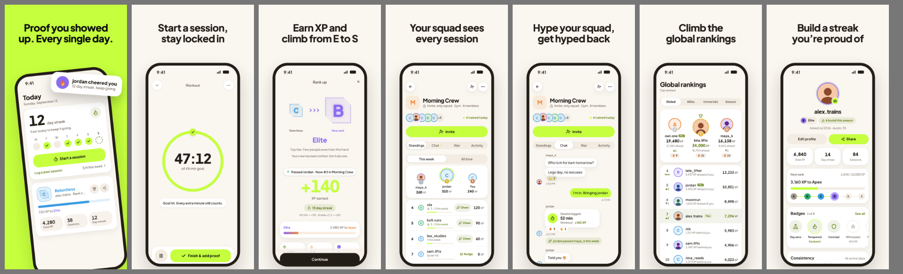
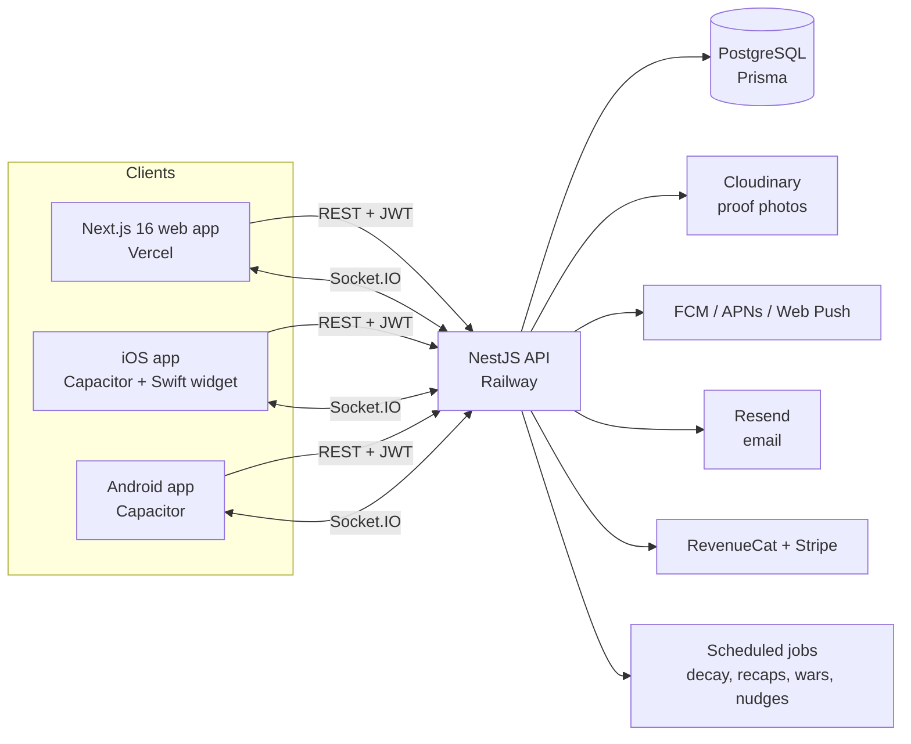

# RankUp

**Ranked discipline. Start a timed session, prove it with a photo, and climb from rank E to S with a squad that sees every session.**

[rankup.club](https://rankup.club) · [App Store](https://apps.apple.com/app/rankup-ranked-discipline/id6789361848) · [Google Play](https://play.google.com/store/apps/details?id=club.rankup.app)

I designed, built, shipped and run RankUp on my own, from the first commit in June 2026 to a live product on the web, iOS and Android. The production code lives in private repos. This repo shows the product, the architecture and a few pieces of real code I'm proud of.

## By the numbers (November 2026)

| | |
|---|---|
| Users | ~400 |
| Completed, photo-verified sessions | 2,100+ |
| Squads | 96 |
| Squad chat messages | 4,300+ |
| Codebase | ~110K lines of TypeScript, 60 Prisma models, 55 migrations, 140+ test files |
| Platforms | Web (PWA), iOS and Android from one Next.js codebase |

## What it does

- **Sessions with proof.** Start a timer for gym, study, deep work or anything else. Finish with a photo. No photo, no XP.
- **XP and ranks.** E → D → C → B → A → S. XP has diminishing returns per session, a streak multiplier, and nightly decay judged at each user's local 3am, with a floor so you never drop below your best rank.
- **Squads.** Small groups with standings, chat, reactions, squad wars and a live "who's working right now" view.
- **Dorm Wars.** A weekly campus competition between dorms (live at the University of Maryland across 37 dorms), recruited with QR flyers, with any school able to start its own.
- **Social layer.** Feed with comments, replies and reactions, DMs, friends, duels, report and mute.
- **Retention loops.** Push, email, a home-screen widget and iOS Live Activities, comeback mode for lapsed users, and a weekly recap email.
- **Monetization.** Pro subscription through RevenueCat (iOS/Android) and Stripe (web).

## Architecture

| Layer | Stack |
|---|---|
| Frontend | Next.js 16 (App Router), React 19, TypeScript, Tailwind, shadcn/ui, TanStack Query, react-hook-form + zod |
| Mobile | Capacitor 7 shell around the web app, native push, Apple/Google sign-in, HealthKit, in-app review, home-screen widget and Live Activities in Swift |
| Backend | NestJS 10, Prisma, PostgreSQL, Socket.IO, `@nestjs/schedule` cron jobs, JWT auth with refresh tokens |
| Infra | Vercel (web), Railway (API + Postgres), Codemagic (iOS builds without a Mac), GitHub Actions |
| Services | Cloudinary, Firebase Cloud Messaging, Resend, RevenueCat, Stripe, Sentry, Vercel Analytics, GA4 |
| Testing | Jest (backend), Vitest + Testing Library (frontend) |

## Engineering problems worth reading

Each file in [`samples/`](samples) is real production code, copied as-is with its tests.

### 1. Rate limiting a campus that shares one IP
[`user-throttler.guard.ts`](samples/backend/user-throttler.guard.ts) · [spec](samples/backend/user-throttler.guard.spec.ts)

The default throttler keys on the client IP. Behind campus Wi-Fi and carrier NAT, a whole dorm shares one address, so students started getting silent 429s. The guard now verifies the JWT (signature and expiry, not just decoding, so nobody can drain someone else's bucket) and rate-limits per user. Login, register and password reset stay per IP on purpose, since those limits exist to slow down one client before an account exists.

### 2. "Today" depends on where you are
[`rest-day.ts`](samples/backend/rest-day.ts) · [spec](samples/backend/rest-day.spec.ts)

Streaks, rest days and nightly decay are about the user's local calendar day, but the server lives in UTC. A US user declaring a rest day at 9pm (already tomorrow in UTC) got it on the wrong date, and users ahead of UTC lost theirs before their night ended. The fix stores a day label (the local day number) and compares day numbers, never instants, with bounded DST-safe stepping.

### 3. An XP formula people can't game
[`xp.service.ts`](samples/backend/xp.service.ts) · [spec](samples/backend/xp.service.spec.ts)

Linear XP turned the leaderboard into "who can leave the timer running longest." Credit now tiers down (full rate for the first hour, half for the second, a quarter after that, capped at 4 hours), with a streak multiplier, a one-time first-session bonus so the very first proof always moves your rank, and a comeback bonus for users returning after a week away. Every award comes with a breakdown the user can tap, because an XP number a competitor can't audit reads as rigged.

### 4. Reactions that feel instant
[`message-reactions.ts`](samples/backend/message-reactions.ts) (server) · [`reactions.ts`](samples/frontend/reactions.ts) (client)

One small reaction model shared by squad chat, DMs and feed comments. The server groups rows into per-emoji summaries and never sends raw user ids. The client applies the toggle optimistically, then reconciles with the server's answer.

## How I work

- Ship small PRs behind tests. Backend migrations run on deploy, and every merge to `main` deploys.
- Read production data before changing behavior. Most features here started from a funnel or retention query, not a guess.
- Run the growth side too: App Store and Play listings, campus flyers, creator partnerships, and analytics to measure what each one did.
- Use AI coding tools heavily. I own the product, the architecture and every decision about what ships.

## Contact

Daniel Nwah · University of Maryland

- LinkedIn: [linkedin.com/in/danielnwah](https://www.linkedin.com/in/danielnwah/)
- Portfolio: [daniel-nwah.vercel.app](https://daniel-nwah.vercel.app)
- Email: [danielnwah123@gmail.com](mailto:danielnwah123@gmail.com)
- App: [rankup.club](https://rankup.club)

---

© 2026 Daniel Nwah. Shared for portfolio review. All rights reserved.
